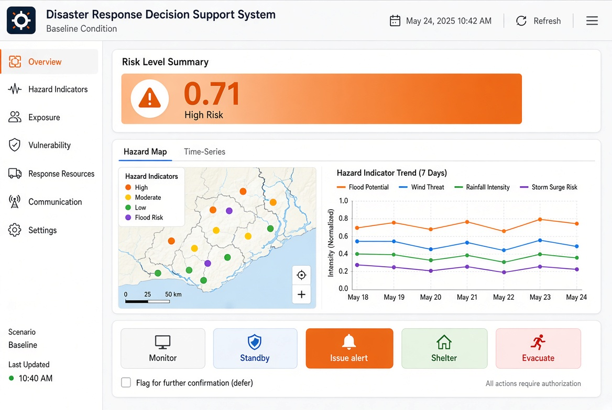
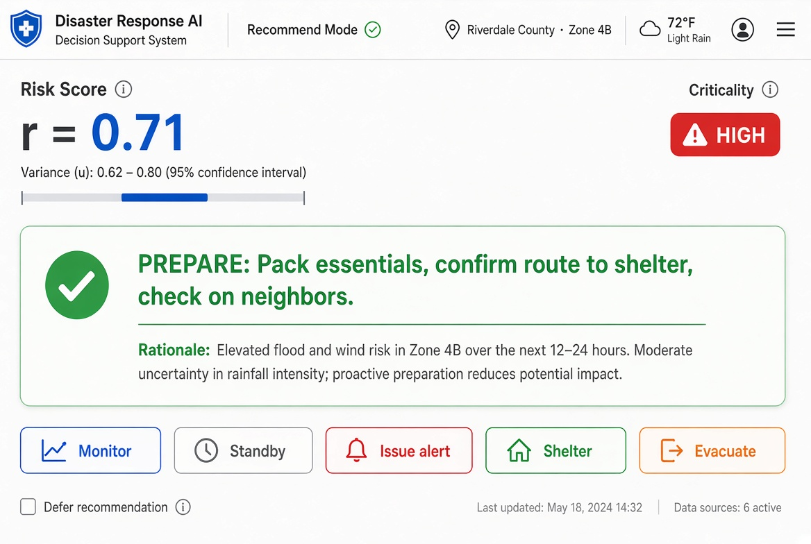
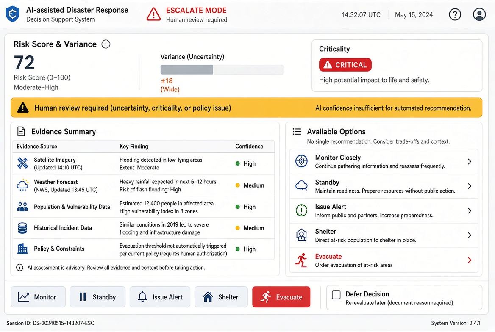

# Supplementary Material

**Manuscript:** "From Alerts to Actions: An Action-Centered Human–AI Decision Support Framework for Disaster Response"

This document collects the study materials that the author's prototype documentation provides, in more detail than the page limit of the manuscript allows. Sections S1–S7 contain no new results. Section S8 describes materials that were re-created from backup storage after the study and are labelled as such, and Section S9 reports robustness analyses of the logs. Everything not documented is listed explicitly in Section S7.

## S1. Interface specification

| Element | Baseline (dashboard) | AI-assisted (ACHDF) |
|---|---|---|
| Hazard and risk information | yes | yes |
| Explicit uncertainty indicator | no | yes |
| Criticality cue | no | yes |
| Guardrail-checked action recommendation | no | yes ("recommend" mode) |
| Escalation prompt with evidence and options | no | yes ("escalate" mode; 150 of 520 trials, 28.8%) |
| Human decides and executes | yes | yes |

**Baseline layout.** Risk-level summary (value and color coding) at the top, a map or time series of risk indicators in the center, and the five response buttons (monitor, standby, issue alert, shelter in place, recommend evacuation) below. No uncertainty, criticality, or recommendation text.

**Recommend mode.** Risk score and uncertainty indicator (confidence interval or variance proxy), a criticality badge, and one guardrail-checked recommendation with a short rationale. The five options remain selectable, so the recommendation can be ignored. The prototype's message templates are:

- High risk: "IMMEDIATE: Move to nearest shelter; bring ID, water, and phone."
- Medium risk: "PREPARE: Pack essentials, confirm route to shelter, check on neighbors."
- Low risk: "STAY ALERT: Monitor updates; avoid low-lying areas."
- Subgroup sentences: elderly, "If mobility is limited, call local support or ask a neighbor for assistance."; migrant, "Multilingual help is available at the community center."

**Escalate mode.** Instead of a single recommendation, the interface shows the evidence and options together with a prompt that human review is required because of uncertainty, criticality, or a policy issue. The participant chooses an action or sets the deferral flag.

**Common elements.** Risk score and variance, a deferral flag ("flag for further confirmation"), automatic logging of the escalation flag, and response-time measurement from stimulus display to response submission.

## S2. Decision task

Each participant completed 10 trials per condition (labels S01–S10), choosing one of five options. Each trial presented the scenario label, time, a synthetic region, four risk factors (hazard, exposure, vulnerability, social), a risk score with its uncertainty, subgroup information (baseline, elderly, migrant), and a situation description of the form "a hazard is in progress in the region; indicators changed over the last hours; the impact on vulnerable groups is at some level."

| Option | Explained meaning |
|---|---|
| Monitor | Continue observing; risk is low and more information is needed |
| Standby | Prepare; risk is rising but it is not yet time to act |
| Issue alert | Alert residents; attention needs to be drawn to the situation |
| Shelter in place | Stay indoors; moving immediately is difficult or dangerous |
| Recommend evacuation | Advise leaving; risk is high and evacuation is required |

Documented example scenarios (original text):

- S01, low risk (about 0.2), intended reference action monitor: "Rainfall is increasing, but the risk of flooding in low-lying areas is still low; further observation is needed."
- S02, medium risk (about 0.5), intended reference action standby or issue alert: "The river level is rising quickly; it is time to advise residents to prepare."
- S03, high risk (0.8 or more), intended reference action shelter in place or recommend evacuation: "The risk of a flash flood is imminent; immediate evacuation or sheltering is required."

The original text of S04–S10 is not available. They varied risk level, vulnerability, and subgroup in the same pattern, and some were designed with high uncertainty so that escalation would be triggered. In the trial logs, however, the reference action stored for a label does not follow this intended pattern (Section VII-D of the manuscript), so these examples cannot be matched to logged trials.

## S3. Training procedure

1. Purpose of the system and the human-in-the-loop principle (5 min).
2. Meaning of the five response options and the asymmetric costs of errors (5 min).
3. Demonstration of the baseline interface, then one practice trial.
4. Demonstration of the AI-assisted interface (recommend and escalate modes, uncertainty indicator, criticality cue, deferral flag), then one practice trial.
5. Introduction to the NASA–TLX, trust, and SUS questionnaires.
6. Start of the experimental trials.

Participants were told that the recommendation is only an aid that they could disregard, that guardrails were applied to displayed recommendations, and that the primary performance measure was the share of trials with the correct action (response time was recorded, but speed alone was not the criterion). They were instructed to focus on taking the appropriate action rather than on analyzing the information. Only steps 1 and 2 have a documented duration.

## S4. Questionnaires

**Trust (1–5, after each condition).** Reliability: "I can rely on the system's recommendations when making decisions." Predictability: "The system's behavior is predictable." Appropriateness: "The system's recommendations are appropriate for the situation." The stored overall trust score equals the mean of the three items (maximum deviation 0.02, rounding). The prototype documentation lists a Korean item "Overall, I trust this system" as a possible separate item, but the stored scores are consistent with the mean of the three items. No published validation exists for these items (Cronbach's alpha .61 baseline, .46 AI-assisted).

**NASA–TLX (0–100, after each condition).** Mental demand, physical demand, temporal demand, performance, effort, frustration. The overall score is the unweighted mean of the six subscales.

**SUS (after each condition).** Standard ten items, 5-point scale, standard scoring to 0–100. The stored overall score exceeds the recomputed score by a constant 2.8 (baseline) and 4.7 (AI-assisted) points in every record; the cause is not documented.

## S5. Prototype configuration (reference implementation)

**Risk model.** Bayesian linear regression with a Gaussian prior on hazard, exposure, 1 − vulnerability, and a social factor plus an intercept; noise variance 0.10, prior variance 2.0. Risk is the posterior mean prediction clipped to [0, 1]; uncertainty is the posterior variance.

**Recommendation bands.** Risk of 0.8 or more gives IMMEDIATE; 0.6 to below 0.8 gives PREPARE; below 0.6 gives STAY ALERT. A third threshold (0.3, "low") is defined in the configuration but not used by the code.

**Guardrail pipeline (order of application).** (1) Base message selected from the risk band; (2) subgroup sentence added; (3) technical terms expanded into plain language (e.g., AER, ECE); (4) deny-list filter, with matches replaced by "[REDACTED]" case-insensitively. Deny terms: "medical diagnosis", "evacuation by force". An "allow terms" list exists in the configuration but is not used by the code.

**Dissemination safety budgets (not part of the user study).** Messages to at most 20% of entities per cycle, a 3-minute rollback window, and at most two alerts per hour for vulnerable groups.

**Escalation.** The escalation algorithm of the manuscript (Algorithm 1) is not implemented in the reference code, and the configuration contains no values for the uncertainty threshold, the criticality threshold, or a criticality scale. In the user study, the escalation flag was pre-assigned per trial in the scenario design and logged.

## S6. Data and analysis

The anonymized participant, questionnaire, and trial-level records (52 participants, 2 conditions, 10 trials) and the analysis script that produces every reported number are distributed with the paper (folders `data/` and `analysis/`).

## S7. Not documented (not available to the author)

- Original screenshots of the study interface (the manuscript's Fig. 2 and the images in S8 are reconstructed illustrations).
- Per-trial stimulus values: risk score, uncertainty, and criticality of each trial.
- The uncertainty and criticality thresholds, the criticality scale, and the values used to pre-assign escalation.
- How the reference action of each trial was derived, whether it was independent of the AI recommendation, and any time window applied in scoring.
- The total training duration and any performance or comprehension criterion.
- Systematic coding of the post-task interviews.
- The original text of scenarios S04–S10.

## S8. Materials re-created from backup storage (post hoc reconstruction)

**Provenance.** The author recovered the following materials from backup storage after the review and re-created or re-organized them for this resubmission. They are *not* original session output and they do not replace the primary study logs. We compared them with the primary trial log: aggregate accuracy is similar (AER 0.815 vs. 0.810), but the selected action is the same in only 22% of the 520 matched AI-assisted trials (about 20% expected by chance) and escalation in 57%; the recovered material contains 208 escalated trials, the primary log 150 (28.8%). The primary log therefore cannot be linked trial by trial to the material below. **No statistic in the manuscript is computed from it.** Because we do not know how well the material represents what participants saw, it should be read as a description of the intended design.

**S8.1 Prototype configuration as re-created.** Escalate if u ≥ 0.25 (posterior variance) or c ≥ 0.70 (0–1 criticality, expert-elicited) or a guardrail flag; recommend mode if r ≥ 0.60 and no escalation. Bayesian linear regression (Gaussian prior, variance 2; noise variance 0.1; four normalized factors plus intercept).

| Scenario | r | u | c | Escalated | Reference action | AI recommendation |
|---|---|---|---|---|---|---|
| S01 | 0.22 | 0.08 | 0.25 | no | Monitor | Monitor |
| S02 | 0.38 | 0.12 | 0.40 | no | Standby | Standby |
| S03 | 0.71 | 0.28 | 0.75 | yes | Shelter | Shelter |
| S04 | 0.52 | 0.15 | 0.55 | no | Issue alert | Issue alert |
| S05 | 0.68 | 0.18 | 0.65 | no | Shelter | Issue alert |
| S06 | 0.86 | 0.32 | 0.90 | yes | Evacuate | Evacuate |
| S07 | 0.45 | 0.10 | 0.45 | no | Standby | Standby |
| S08 | 0.75 | 0.27 | 0.78 | yes | Evacuate | Shelter |
| S09 | 0.30 | 0.09 | 0.30 | no | Monitor | Monitor |
| S10 | 0.58 | 0.14 | 0.72 | yes | Shelter | Shelter |

Conflict with the primary log: four escalated scenarios shown to 52 participants give 208 escalated trials, but the primary log has 150. The primary log supports 150: it records escalation in 8 to 20 of the 52 participants for every scenario label (none is escalated for all or for none), which does not fit a design in which four labels are always escalated. The manuscript therefore keeps 150 (28.8%), and the 208 of this table is not used.

**S8.2 Reference actions (expert ratings as recovered).** Four experts (7–15 years of experience; government agency, university, local government, NGO) rated each scenario independently, then discussed disagreements. Initial agreement was 4/4 in five scenarios (S01, S04, S05, S06, S09) and 3/4 in five (S02, S03, S07, S08, S10); discussion resolved all ten. The recovered file also states that the reference actions were fixed before the AI recommendations were produced and a "consensus rate of 92%", which does not match its own table. The file is a re-organized record, not a contemporaneous one, so independence from the AI recommendation is stated by the author but not verifiable from the files.

**S8.3 Training protocol as recovered.** Planned duration 15–25 minutes. Pass criterion: correct action in all practice trials and verbal confirmation that the participant may disregard the AI recommendation and keeps final decision authority; failed practice trials were repeated (at most two additional attempts). The recovered records list all 52 participants as passing, with durations from 15.1 to 24.0 min (mean 19.6, SD 2.8) and 3–5 practice trials (six participants needed more than the three standard ones). The recovered summary line (mean 18.4 min; eight participants) differs from its rows. These records were re-organized after the study.

**S8.4 Interface images.** The three images below were re-created by the author and show scenario S03 values (the recovered README calls them pilot-test captures); they are **illustrative reconstructions, not verified screenshots of the study software**. They carry different dates (2025 and 2024) and score scales (risk 0.71 and 72), so they must not be read as original captures.

**S8.5 Not reported.** The recovered material also includes a trial-level log with AI recommendations and correctness labels and an automation-bias summary computed from it. We do not report those figures: because the log does not match the primary log, they would not be evidence about the study. Automation bias and trust calibration therefore remain unassessed (manuscript §VII).

## S9. Robustness analyses that do not depend on the undocumented items

These analyses use only fields that the primary log records (condition, order, selected action, recorded reference action, latency). They answer three concerns that the records cannot settle directly: that scenario identity and difficulty across conditions cannot be verified, that carry-over cannot be excluded, and that the result might depend on a few participants or on the mix of reference actions. They are exploratory, were added after the review, and change no reported number (script `analysis/robustness.py`).

| Check | Result |
|---|---|
| First period only (between-subjects: 28 AI-first vs. 24 baseline-first participants; no carry-over, no repeated scenarios), AER | 0.825 vs. 0.642; difference +0.183, 95% CI [0.079, 0.287], Welch t(40.9) = 3.56, p = .001; Mann–Whitney p = .001 |
| First period only, latency | 8.09 vs. 12.28 s; difference -4.19 s, 95% CI [-4.60, -3.78] |
| Trial-level logistic GEE adjusted for the reference action and order | OR = 2.61, 95% CI [1.97, 3.46], p < .001 |
| AI-assisted AER re-weighted to the baseline reference-action mix | 0.814 (unweighted 0.810) |
| Participants with a higher AER under AI support | 42 of 52 (equal 5, lower 5); sign test p < .001 |
| Paired sign-flip permutation test of the AER difference | p < 5 × 10⁻⁵ (20,000 flips) |
| Without the three participants with the largest absolute differences | mean difference +0.169, t = 6.49, p < .001 |

**AER by recorded reference action.**

| Reference action | Baseline | AI-assisted | Difference |
|---|---|---|---|
| Issue alert | 0.71 | 0.78 | +0.07 |
| Monitor | 0.58 | 0.84 | +0.26 |
| Recommend evacuation | 0.56 | 0.78 | +0.22 |
| Shelter in place | 0.64 | 0.84 | +0.20 |
| Standby | 0.60 | 0.80 | +0.19 |

The AI-assisted AER is higher for every reference action. The first-period latency difference is reported as a raw difference only: between-participant variance is very small in these records (see manuscript Section IV-F), which makes standardized effect sizes extreme.

**What these analyses do and do not show.** They show that the primary result does not depend on repeated scenarios, on carry-over, on the mix of recorded reference actions, or on a few participants. They cannot show that the recorded reference action was derived independently of the AI recommendation, or that the scenarios were matched in difficulty, because the records contain no information on either.
